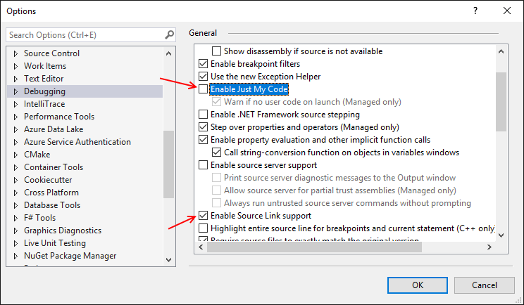
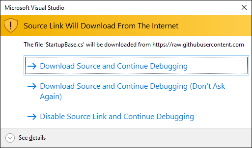

# How to debug

The projects are built with [Source Link](https://github.com/dotnet/sourcelink) enabled and are configured to include PDB files within the NuGet packages themselves. This allows source code files to be downloaded from our GitHub repo directly during debugging process.

## Enable debugging in Visual Studio

To enable debugging in Visual Studio, you need to:

1. Uncheck "Enable Just My Code".
2. Check "Enable Source Link support.

When debugging into the code, Visual Studio will ask to download source code from GitHub.

Click "Download Source and Continue Debugging" to continue.

## Reindex E2E cache timing

When running reindex E2E tests against a remote server, set
`TestSearchParameterCacheRefreshIntervalSeconds` to the server's
`FhirServer:CoreFeatures:SearchParameterCacheRefreshIntervalSeconds` value.
It must be an integer from 1 to 429496 seconds (so the polling budget fits a
cancellation timer) and defaults to 20 when unset.
This is a **test-only timing setting**: it does not change the server's configuration.
In-process tests ignore this environment variable and read their server's effective
configuration (normally 1 second).

The tests use the interval to allow three cache refresh cycles before testing
resource-write indexing, and to bound search-parameter status polling to five
refresh cycles. The URL-change test exits polling as soon as both expected
statuses are observed; a timeout includes the last responses for diagnosis.