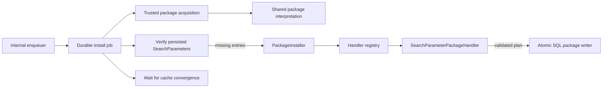

# Design: FHIR NPM Package Reader and SearchParameter Installation Handler

**Status**: Proposed (implemented in the draft PR; awaiting the published Ignixa 0.6.82 for final verification)
**Work item**: AB#206131
**Parent feature**: install SearchParameter resources from FHIR NPM packages when a new service is provisioned

## Context

The service will install `SearchParameter` resources from a versioned [FHIR NPM package](https://hl7.org/fhir/packages.html) while a new service is being provisioned. Four stories deliver it:

| Story | Responsibility |
|---|---|
| **AB#206131 (this design)** | Read a package tarball safely; validate the complete SearchParameter set; report installed and ignored content |
| AB#213137 | Atomic SQL writer and empty-store bootstrap (parameters created `Enabled`) |
| AB#211144 | Durable install job, deployment-owned source allow-list, exact-version acquisition, and cache convergence |
| Future slice | Desired-state reconciliation and provisioning readiness |
| AB#206134 | Applied-package and job status, `CapabilityStatement.implementationGuide` |

Design constraints from the feature:

- Only `SearchParameter` resources are installed. Profiles, extensions, terminology, examples and executable content are ignored and reported. Non-core package dependencies are never resolved.
- The reader is separate from resource-type installation handlers, so later conformance types are added without changing the artifact format or the acquisition boundary.
- Safety checks (integrity, size limits, decompression bombs, path traversal) happen before anything is extracted to disk or written to the store.
- The complete SearchParameter set is validated as one unit. One invalid parameter fails the whole package.

### Acceptance criteria (AB#206131)

1. A valid SearchParameter-only package for the server's FHIR version reads and validates end to end.
2. A package that also contains `StructureDefinition`, `ValueSet` and so on installs only the SearchParameters and names the ignored types in the result.
3. Integrity-hash mismatch, oversized archive, zip-bomb expansion ratio, and path-traversal or absolute-path entries are each rejected before extraction to disk or any write, with an actionable `OperationOutcome`.
4. A package declaring a mismatched FHIR core dependency is rejected.
5. A package with one invalid SearchParameter fails the whole set; nothing is persisted.
6. A composite parameter whose components can't be resolved is rejected (see decision 5; AC6 on the work item has been updated to match).
7. Unit tests cover every rejection case and the ignored-resource-type reporting.

## Where this sits in the flow



The original reader story covers everything from "a tarball and its expected integrity are available" through a validated SearchParameter set and a result naming installed and ignored content. The durable job now supplies acquisition and recovery; it does not create package records, track ownership, or change the CapabilityStatement.

## Decision

### Build the reader on Ignixa.PackageManagement strict extraction

The server is migrating to the Ignixa SDK (ADR-2607). `Ignixa.PackageManagement` 0.6.82 adds `PackageExtractor.ExtractStrictAsync` and `NpmPackageAcquirer`, which already provide most of the archive safety this story needs:

- In-memory extraction only: nothing on disk, no scripts.
- Configurable compressed, expanded, per-entry, entry-count and JSON-depth limits, counted on the bytes actually streamed.
- Exactly one `package/package.json`; relative POSIX paths under `package/` only. Traversal, absolute paths, backslashes, links, special entries, case-insensitive collisions, malformed gzip/tar, trailing data and duplicate JSON properties are rejected.
- Errors carry no package content: `PackageExtractionException.Diagnostic` has a code, the physical entry index and the configured limit.
- The durable job's acquirer checks a source allow-list, requires SHA-512 SRI integrity over the compressed bytes before extraction, confirms name/version identity, and provides an authentication callback and bounded retry. It does not resolve dist-tags.

`Firely.Fhir.Packages` was considered and rejected: it extracts to disk, does no SRI verification, has no size, entry-count or path limits, and goes against the migration direction.

**Placement.** Interfaces and models (`IFhirPackageReader`, `FhirPackage`, `FhirPackageReaderOptions`, handler contracts) go in `Microsoft.Health.Fhir.Core/Features/FhirPackages/`. The Ignixa-backed reader goes in `Microsoft.Health.Fhir.Ignixa/Features/FhirPackages/`. SQL hosts register it independently of `CoreFeatures.FhirSdkProvider`: package reading has no Firely equivalent, so it is a new capability rather than a migrated seam. ADR-2607 now has a section saying so ("New capabilities built on Ignixa"). The SearchParameter handler stays on Firely POCOs, because search indexing and `SearchParameterInfo` are still Firely-based (ADR-2607 Phase 3).

### Reader: `FhirPackageReader`

The Core-facing seam is SDK-neutral: `IFhirPackageReader.ReadAsync(Stream tarball, FhirPackageDescriptor descriptor)` returns a `FhirPackage`, where the descriptor holds `PackageId`, `Version` and the expected SHA-512 `Integrity`. The returned `FhirPackage` and `FhirPackageInstallResult` carry that same descriptor in their `Descriptor` property; it is attached only after the hash and manifest identity checks pass, so it doesn't duplicate the identity fields. No Ignixa type appears in Core or in the job that calls the reader.

The Ignixa-backed implementation in `Microsoft.Health.Fhir.Ignixa` has two inputs that share one interpretation path:

- **Stream** (the Core seam): buffers up to the compressed cap, verifies SHA-512 (`NpmPackageIntegrity`, `SHA512.HashData`, fixed-time compare), checks the manifest name and version against the descriptor, then calls `ExtractStrictAsync` with limits built from `FhirPackageReaderOptions`. This is the tarball-to-validated-package seam the story requires, not just a test hook.
- **Acquired package** (internal to the Ignixa integration): the adapter constructs the trusted policy and calls `NpmPackageAcquirer` itself. It passes the resulting `AcquiredNpmPackage` through the same internal `Interpret(StrictPackageExtractionResult, FhirPackageDescriptor)` step, so post-extraction checks can't diverge. The guarantees the adapter relies on, and who establishes each:

| Guarantee | Established by |
|---|---|
| Source is on the allow-list | `NpmPackageAcquirer`, from the deployment-owned `NpmPackageSourcePolicy` |
| SHA-512 integrity of the compressed bytes | `NpmPackageAcquirer`; the descriptor uses the verified `AcquiredNpmPackage.Integrity`. |
| Name and version identity | `NpmPackageAcquirer` (metadata and manifest identity); the adapter re-checks the manifest against the descriptor |
| Configured limits | The adapter constructs the policy's `ExtractionLimits` from the same `FhirPackageReaderOptions`; `NpmPackageAcquirer` enforces them and `Interpret` checks the expansion ratio. |

Strict extraction alone is never treated as proof of integrity, identity or the configured limits.

Checks run in this order. Each failure produces an actionable `OperationOutcome` before any handler runs:

1. Stream input only: the compressed-size cap, then SHA-512 integrity.
2. Ignixa strict extraction, with our limits mapped to `PackageExtractionLimits` using checked `int` conversion.
3. Expansion ratio: `ExpandedBytes` must not exceed `CompressedBytes × ratio`, compared in `long` arithmetic with no integer division. Ignixa has no ratio limit. The check runs after the strictly bounded in-memory extraction and before any handler or write. It satisfies AC3's no-disk, no-write boundary, but it doesn't prevent the decompression work itself; the expanded-size cap is what bounds that.
4. Manifest:
   - Name and version must equal the descriptor.
   - The FHIR core dependency (`dependencies["hl7.fhir.<r3|r4|r4b|r5>.core"]`, and `fhirVersion`/`fhirVersions` if present) must exactly equal `IModelInfoProvider.SupportedVersion.VersionString`.
   - Non-core dependencies are reported as information and never resolved.
5. Classification:
   - Top-level `package/*.json` entries with a `resourceType` go to the installer.
   - Resources in sub-folders (`example/`, `other/`, …) are ignored and reported.
   - Metadata JSON such as `.index.json` is expected package content and isn't reported. Non-JSON files are dropped by Ignixa and aren't reported either, because its statistics don't separate them from directories.

`FhirPackageReaderOptions` defaults (configurable under `FhirPackageReader`):

| Limit | Default |
|---|---|
| Compressed size | 10 MB |
| Expanded size | 50 MB |
| Per entry | 5 MB |
| Entries | 1,000 |
| JSON depth | 64 |
| Expansion ratio | 100:1 |

### Handlers: `IFhirPackageResourceHandler`

Handlers work in two phases: every handler validates before anything is written.

```csharp
string ResourceType { get; }
Task<IFhirPackageInstallPlan> ValidateAsync(IReadOnlyList<FhirPackageEntry> entries, FhirPackage package, CancellationToken cancellationToken);
```

The handler registry is built from DI. This release registers only `SearchParameter`.

### `SearchParameterPackageHandler` (Shared.Core)

It validates the complete set as one unit and collects every failure into one `OperationOutcome`:

- **Parsing:** each entry is parsed with a strict `FhirJsonParser` into a `SearchParameter`. Only `FormatException`, which is what the parser throws for malformed JSON and unknown elements, is treated as invalid content.
- **Per parameter:**
  - the URL is present, absolute and at most 128 characters;
  - code, base, type and expression are present;
  - every component has an expression and a `definition` that is an absolute URI. This is checked on the raw text before anything constructs a `Uri` from it, so malformed definitions become issues instead of exceptions.
  - If those pass, `IModelAttributeValidator` validates the resource recursively. That covers FHIR-model requirements the indexing checks don't, such as `name`, `status` and `description`.
- **Within the package:** URLs are unique, and no code is used by two members on the same *effective* resource type. `Resource` and `DomainResource` bases are expanded to the concrete types that inherit them, using the same model rules as existing validation, so a `Resource`-based member collides with a `Patient`-based one regardless of entry order.
- **Against the server's reference set**, refreshed first with `GetAndApplySearchParameterUpdates`:
  - no URL collides with a system-defined parameter;
  - code conflicts per base type follow the same `SearchParameterComparer` rules as `SearchParameterValidator`, including `Resource`/`DomainResource` expansion.
- **Composites:** each `component.definition` must resolve to a parameter in the same package, or to an existing definition (core or custom) whose status is `Enabled` or `Supported` (decision 5). Same-package resolution doesn't depend on the order of entries in the archive, and a component may not itself be a composite.
- **Expression compilation:** the expression and every component expression are compiled with the same `FhirPathCompiler` configuration the indexer uses. Compilation binds every function, including those inside `where()` predicates, which the support resolver doesn't inspect, so an expression that would fail at indexing time is rejected as `invalid` here.
- **Data-store support:** `SearchParameterInfo`s are built for the set, with an overlay so same-package composite components resolve, and run through `ISearchParameterSupportResolver.IsSearchParameterSupported`. Unsupported or partially supported parameters are rejected, and the data store's own rules (`IDataStoreSearchParameterValidator`) run last. Rejecting partial support is stricter than the single-resource create path, which accepts it: a provisioned parameter that silently misses some target types is worse than a failed install. Valid FHIRPath that the resolver can't follow (for example `last()`, `select()` or arithmetic) is reported as `not-supported`, and paths or types the FHIR model doesn't define are reported as `invalid`, so every parameter in the set is still checked.

Reuse: the code-conflict and comparison logic in `SearchParameterValidator` moves unchanged into the internal static `SearchParameterConflictRules`, which takes its dependencies as arguments. The per-request validator and the package handler then share the rules. No lookup abstraction is needed: package members are checked against each other separately (duplicate URL and code), and against the current definitions through the existing definition manager. The per-request validator keeps its `DataActions.Reindex` authorization check, which the package path must not hit because there is no user context.

### Validation-to-write handoff

Refreshing the reference set before validation doesn't keep it unchanged until persistence. The contract between this story and AB#206132:

- The handler captures `ISearchParameterOperations.SearchParamLastUpdated` immediately after the refresh. This is the same reference-set token the single-resource create path passes downstream.
- The plan carries that token, and `ISearchParameterPackageWriter.WriteAsync` receives it.
- Inside one serialized SearchParameter change, the writer must reject the write with a retryable conflict, or revalidate, if the reference set has changed since the token. It must commit the complete set atomically. Looping ordinary per-resource writes doesn't satisfy this.
- The installer checks for cancellation after validation and before any write. A plan's URLs are *planned*; the install result reports a type's URLs as installed only after its plan's `ApplyAsync` succeeds.

This story tests the token handoff, no writer call after a validation failure, and cancellation before writing. Transaction, rollback and race tests belong to AB#206132.

### Installer and result

`FhirPackageInstaller.InstallAsync` receives a `FhirPackage` from the reader, sends root entries to handlers, validates everything, and only then applies the plans, which call `ISearchParameterPackageWriter` (implemented in AB#206132).

`FhirPackageInstallResult` reports:

- package id, version and integrity;
- installed canonical URLs, by resource type;
- ignored resource types with counts;
- non-core dependencies;
- information issues for all ignored content. On failure, `FhirPackageException` carries every error issue.

Error mapping:

| Failure | `OperationOutcome` issue code |
|---|---|
| Integrity mismatch, malformed or non-SHA-512 expected integrity, unsafe path, link or special entry | `security` |
| Size, count, ratio or depth limit | `too-costly` |
| FHIR version mismatch | `not-supported` |
| Invalid manifest, archive or SearchParameter | `invalid` |
| URL or code collision | `conflict` |

Messages go in `Resources.resx`.

## Decision log

| # | Topic | Decision |
|---|---|---|
| 1 | Story boundary | Stop at a validated plan plus `ISearchParameterPackageWriter`. AB#206132 implements the write. "Nothing persisted" is tested with a substitute writer. |
| 2 | Integrity | SHA-512 SRI only (npm `dist.integrity`), matching Ignixa. SHA-1 `shasum` is not accepted. |
| 3 | Non-core dependencies | Never resolved. Ignored and reported as information. |
| 4 | FHIR core version | Must match `SupportedVersion.VersionString` exactly, e.g. `4.0.1`. |
| 5 | Composite components | **Decided by the owner (2026-10-12):** a component may resolve to a parameter in the same package, or to any existing definition (core or custom) whose status is `Enabled` or `Supported`. Definitions in any other state are rejected, and the error names the state. The work item's AC6 and ADR-2608 are updated to match. Tradeoff accepted: the same package can validate differently on different services, and in this release the package doesn't record a dependency on a definition it doesn't own, so retiring that definition isn't blocked. On an empty store the only existing definitions are system-defined, so bootstrap installs behave as core-or-same-package. Dependency tracking belongs with the existing-service design. |
| 6 | SearchParameter `status` | Not an install filter. `draft`, `active`, `retired` and `unknown` all install. |
| 7 | Limits | Configurable `FhirPackageReaderOptions` with the defaults above. |
| 8 | SDK | Ignixa.PackageManagement strict extraction. SQL hosts register the reader independently of `FhirSdkProvider` (decision 10). Firely.Fhir.Packages rejected. |
| 9 | Empty packages | A package with no installable resources at its root is rejected as `invalid`; it almost certainly means a packaging mistake. |
| 10 | DI registration | The durable-job slice registers the reader, handler, installer, SQL writer and acquisition adapter for SQL hosts. |

## Tests

xUnit and NSubstitute, Arrange-Act-Assert. Test tarballs are built in memory with `TarWriter` and `GZipStream`. One small checked-in package produced by a real `npm pack` proves that partner-pipeline output passes strict extraction. Ignixa's internal checks are not re-tested; the tests cover our integration and observable outcomes. Failed validation and writes rejected before commit make no changes, but matching resources may already exist from an earlier attempt. A connection failure during commit can leave its outcome unknown; recovery checks the persisted resources:

- **Reader failures** (integrity, limits, unsafe paths, manifest): neither the installer's handlers nor the writer are called.
- **Handler validation failures:** the handler necessarily runs, but the writer is never called.

| AC | Tests |
|---|---|
| 1 | A valid SearchParameter-only package reads and validates end to end (per FHIR version, through Shared tests) |
| 2 | StructureDefinition, ValueSet and examples are ignored and named in the result and `OperationOutcome` |
| 3 | Integrity mismatch; malformed or non-SHA-512 integrity; compressed cap; expanded cap; ratio just below, at and above the limit; entry-count cap; `../x`, `/abs`, `C:\x`, backslash paths; symlink and hardlink entries. Stream and acquired-package inputs give identical results. |
| 4 | Core dependency mismatch or missing; `package.json` missing or invalid; name or version differs from the descriptor |
| 5 | One invalid SearchParameter among valid ones: writer never called, all issues reported; cancellation after validation: writer never called |
| 6 | Composite resolves to same-package parameters regardless of entry order, and to existing `Enabled` or `Supported` definitions; a component's own expression is parsed and compiled (tested with the real `SearchParameterSupportResolver`). Rejected: an unresolvable component, an existing definition in any other status, a composite component, a component without an expression, and a component whose definition is missing or isn't an absolute URI, including STU3's reference form. |
| 7 | Duplicate URL or code within the package, including two members colliding through `Resource` or `DomainResource` in either entry order, with acceptance for unrelated concrete bases; missing `name`, `status` or `description` through model validation; collision with a system-defined URL; code collisions with existing definitions through `Resource` and `DomainResource`; support-resolver and data-store rejections (writer never called); expressions that don't compile, including unknown functions inside `where()`; expressions the resolver can't follow (`last()`, `select()`) or that cast to an unknown type, each reported without aborting validation of the rest of the set; the reference-set token reaches the writer |

## Delivery

0. **Dependency bump:** `IgnixaPackageVersion` 0.6.74 → 0.6.82 (the release that includes brendankowitz/ignixa-fhir#464). Polly 8.5.2 → 8.6.6. Add `Semver` 3.0.0, a new transitive dependency. `Ignixa.Extensions.FirelySdk5` 0.6.82 still pins Hl7.Fhir 5.11.4, which matches this repo. Re-run the `$import` parity tests, because the shared version property also moves the `$import` packages.
1. Reader on Ignixa (stream input, the shared `Interpret` step, ratio, manifest and core-dependency checks, classification, error mapping), `FhirPackageReaderOptions`, tests including `npm pack` fixtures and an end-to-end tarball-to-writer test, and the ADR-2607 note.
2. Handler contracts, SearchParameter set validator, `SearchParameterValidator` refactor, installer and result, tests.

The SQL durable-job slice adds the internal enqueuer and acquisition adapter. Desired-state reconciliation and provisioning readiness remain separate work.

### Implementation status

| Piece | Status |
|---|---|
| Ignixa 0.6.82 and Polly 8.6.6 bump | Done; `$import` tests pass on all four FHIR versions |
| Contracts: `FhirPackage`, `IFhirPackageResourceHandler`, `IFhirPackageInstallPlan`, `ISearchParameterPackageWriter`, `FhirPackageException` | Done |
| `FhirPackageInstaller` and `FhirPackageInstallResult` | Done, with unit tests |
| `SearchParameterConflictRules` extracted from `SearchParameterValidator` | Done; existing validator tests pass |
| `SearchParameterPackageHandler` | Done, with unit tests on STU3, R4, R4B and R5 |
| `IgnixaFhirPackageReader`, `FhirPackageDescriptor`, `FhirPackageReaderOptions` | Done. Tests cover integrity, every limit, ratio boundaries, unsafe paths and links, manifest and core-dependency rules, classification, `npm pack` fixtures for all four FHIR versions, and an end-to-end path from tarball to writer |
| ADR-2607 note on new Ignixa capabilities | Done |
| Acquired-package adapter | Used by the durable install job |

### Durable job configuration and recovery

The queue is disabled by default. Enable `FhirServer:Operations:FhirPackageInstall:Enabled` on every active SQL host so each publishes cache proofs, enable `TaskHosting:Enabled` on the hosts that run jobs, and configure one or more deployment-trusted sources under `FhirPackageAcquisition:Sources`. Each source has an HTTPS `Registry` directory, one or more `AllowedArtifactPrefixes` HTTPS directories, an optional Azure `TokenScope`, and an optional `MaxRedirects` (default zero). The registry must provide standard npm exact-version metadata with a tarball URL and SHA-512 integrity; direct-download-only registry APIs are not supported. The Azure credential is sent only to URLs under the registry directory, not to other artifact hosts. The internal enqueuer takes the source identifier, exact npm package name and exact version; it does not resolve dist-tags.

Acquisition timeouts and HTTP 408, 429, 500, 502, 503 and 504 are reported as retryable. Ignixa exposes the same sanitized `TransportFailure` for transient network failures and permanent TLS trust failures; the job reports that category as potentially retryable and advises checking both connectivity and certificate trust. Ignixa itself does not retry TLS failures. Other acquisition failures are reported as non-retryable.

SQL failures retain the last positively verified job state and are marked retryable only when the existing SQL retry classifications identify a transient failure. A connection failure during commit can still leave the write outcome unknown; the next attempt checks the persisted resources.

Like reindex, the enqueuer first looks for an active (queued or running) install job and returns it when its package ID, version and source match; otherwise it enqueues a definition with a new GUID `Id`, so failed and cancelled jobs are never reused and a later request starts a new attempt. The active-job check and the enqueue are not atomic, so simultaneous requests can create two jobs for the same package; the writer's create-only, optimistic-concurrency writes prevent duplicate resources, and the losing job fails with a retryable conflict. Recovery re-fetches the package and compares its SearchParameters and enabled statuses with persisted resources; matching parameters are reused and only missing parameters are validated and written. No package table, provenance tags or package-removal detection are used, so recovery requires the source to remain available.

After all requested parameters are verified locally, the job waits for two matching cache proofs per active host at or beyond the installed status watermark. Each proof includes a fingerprint of that host's actual definitions, statuses and resource-type hashes; the job rechecks the persisted package and requires the shared fingerprint to match its own cache. Hosts that have not enabled the feature, or are running older code without proofs, prevent convergence. A bounded timeout fails the job with `IsRetryable = true` and records `Committed` in the failure result; this state is not persisted as intermediate queue progress. The cache refresh interval and the package queue's `CacheUpdateMaxWaitMultiplier` and `ActiveHostsEventsMultiplier` control the wait.

Active hosts are identified by recent SQL `EventLog` activity grouped by SQL `HOST_NAME()`, not by deployment membership. This assumes distinct host names and regular SQL activity; silent instances or multiple instances sharing a host name cannot be distinguished. Provisioning must keep ordinary resource writes blocked and coordinate host membership until convergence; that readiness gate is a separate slice.

## Consequences

- **Benefits:**
  - Archive safety comes from a library with extensive boundary tests rather than new tar-handling code.
  - The handler split lets later conformance types reuse the reader unchanged.
  - The rules for single-resource and package validation can't drift apart.
- **Costs:**
  - A new dependency closure: `Ignixa.Validation`, `SharpZipLib`, `Superpower`, `Fhir.Metrics`, `Semver`, and the Polly bump.
  - The first unconditional Ignixa code path, which differs from ADR-2607's per-seam toggle.
  - Ignixa's strictness may reject unusual but valid tarballs. The `npm pack` fixture covers the expected producer.
- **Known limitations:**
  - Custom SearchParameters on the SearchParameter resource type aren't supported. The writer (AB#213137) enables package parameters without reindexing, and its empty-store check ignores SearchParameter resources so later packages can still install. Such a parameter would never index SearchParameter resources already in the store, so validation rejects any package parameter whose base covers SearchParameter (directly or via `Resource`/`DomainResource`) with a `NotSupported` issue.
- **Neutral:**
  - The expansion ratio is checked after a bounded in-memory extraction rather than while streaming. Memory is still bounded by the expanded-size cap.
