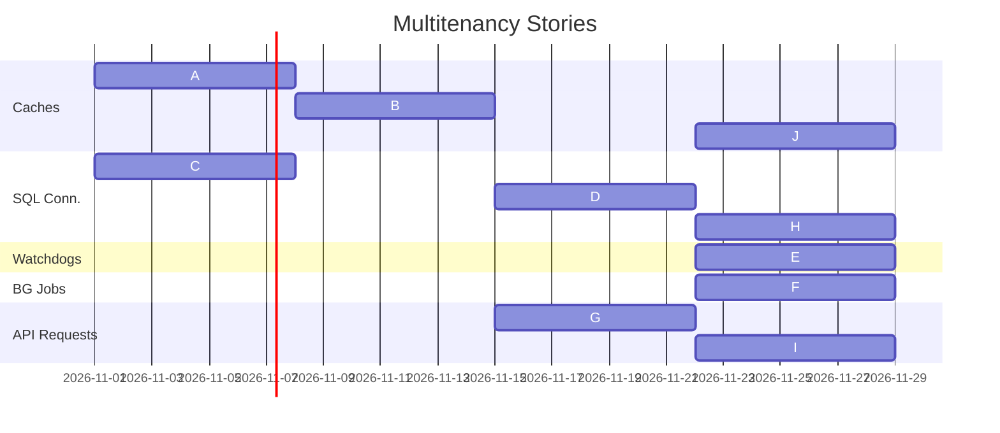

## MVP
-	<b>Multiple Databases, one Elastic Pool</b>. Use EP connection strings to remove the need for tenant specific connection strings.
-	<b>Unify caching logic</b>. All tenant specific caches should be moved to a single cache management class. A tenant manager will then hold a dictionary of these cache managers. Users of existing caches will now call the tenant manager to get the cache manager for the current tenant. The cache manager will be responsible for keeping the caches up to date.
-	<b>Multitenant watchdogs</b>. One instance of a watchdog need to run against all tenants simultaneously to avoid favoring one tenant.
-	<b>Multitenant background jobs</b>. Each instance has a limited number of threads for each background job type. It should cycle through the tenants, picking up jobs in a round robin pattern to avoid having one tenant hog all the background job slots. Job definitions will need to be updated to include a tenant id so that the background job can be associated with a specific tenant. 
-	<b>Multitenant API requests</b>. The tenant id will be part of the url. The existing controllers will need to be updated to match the new url pattern and the tenant id will need to be added to the request context so that it can be used by the other services.
-	<b>Multitenant SQL requests</b>. The SQL server services need to pull the tenant id out of the context and send the request to the correct database.
- <b>Single Tenant Application</b>. The application should be able to run in single tenant mode if no tenants are configured. This will be identical to the current application behavior.

## Stories
Description (Pre-requisite)
A.	Create cache management class v1. For this version it only needs to return built in search parameters, it should not access the DB yet. It will also return an empty list of profiles and other system resources. 
B.	Create tenant management class. This will include adding a tenant configuration section to appsettings that will contain a list of tenants. At this time the configuration only needs to contain a tenant name and id (which will be the database name). (A)
C.	Enable SQL connections to work with EP connection strings. 
D.	Enable SQL to connect to tenant specific DBs. (B, C)
E.	Enable watchdogs to run on multiple tenants. (D)
F.	Enable background jobs to run on multiple tenants. (D)
G.	Create tenant catching middleware. This will add the tenant of the current request to the request context. This story also includes making existing controllers match URLs that contain the tenant id segment. (B)
H.	Enable SQL to connect to the DB of the request’s tenant. (D, G)
I.	Enable requests to use the cache of the request’s tenant. (G)
J.	Enhance cache management. Have it pull from tenant specific DBs so that it has correct SP and other system resources. (D)

This ordering of stories will leave parts of the FHIR service non-functional until the last story is completed. This is acceptable for the MVP since we are isolating the work to a single branch and will not be merging it into the main branch until it is complete.

## Open Questions
- Authentication: Does each tenant have its own authentication or is it shared across tenants? What about user rolls and permissions?
- Common search parameters: Can we share spec defined search parameters across tenants or do we need to maintain separate copies for each tenant? If we share them, how do we handle disabling spec defined search parameters for a specific tenant?
- Background job slot allocation: How do we determine how many background job slots each tenant gets? Should we prevent one tenant from taking all the slots or should we allow it to take all the slots if no other tenants have jobs to run?
- Configuration settings: How do we handle configuration settings that are shared across tenants? Should we have a single configuration for all tenants or should each tenant have its own configuration?

## Out of Scope
- PaaS intigration: This MVP will not include any integration with the PaaS service.
- Pipeline integration: This MVP will not include any integration with the existing OSS PR or CI pipelines.

