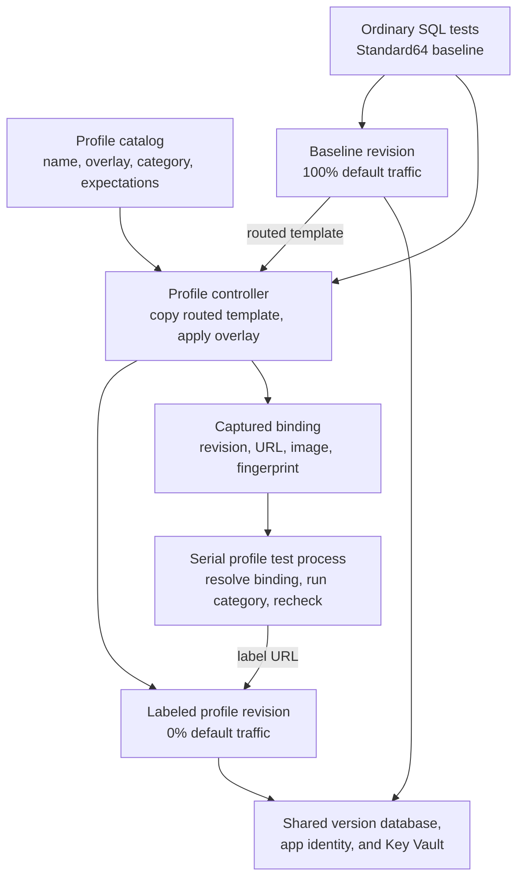

# ADR-2611: Alternate E2E configuration profiles

**Status**: Proposed
**Date**: 2026-11-16
**Feature**: Alternate E2E configuration profiles

## Context

Some end-to-end tests need a server configuration that differs from the ordinary SQL test deployment. The tests must exercise the deployed HTTP endpoint without changing the configuration or default traffic used by other tests. Provisioning a separate app for every configuration duplicates deployment resources and makes it harder to verify that tests use the same build and database.

[PR #6020](https://github.com/microsoft/fhir-server/pull/6020) proposes profiles for the existing SQL Azure Container Apps (ACA), one app per supported test version. The first profile exercises the product-specific long resource ID configuration. [FHIR R4 defines an `id` limit of 64 characters](https://hl7.org/fhir/R4/datatypes.html#id). The Long128 tests deliberately accept IDs of 65 through 128 characters, so that behavior is non-standard, not a FHIR conformance claim.

## Options considered

1. **Change the ordinary deployment's configuration for each test run.** Rejected because other consumers could observe the changed configuration and traffic.
2. **Provision a separate app for each configuration.** Rejected because it duplicates app resources. A separate database would also lose the shared-database test environment.
3. **Use labeled revisions of the existing SQL app.** Chosen because a revision can carry an environment overlay and have a dedicated endpoint while the baseline retains default traffic.

## Decision

Use the [revision profile catalog](../../build/jobs/scripts/RevisionProfiles.psd1) to describe each alternate configuration with a name, revision slug, test category, and environment overlay. Resource ID expectations are separate metadata and default to `None` when omitted. `Long128` is the only alternate profile in the catalog. It enables long IDs and disables task hosting, database creation, automatic schema updates, and startup data deletion. SQL initialization remains enabled.

For each of Stu3, R4, and R5, the profile stage follows the ordinary SQL test stage. The controller copies the explicitly routed, authenticated Standard64 baseline revision's template, including its digest-pinned image, and applies the profile overlay. The app uses multiple revisions. Default ingress remains pinned at 100% to the baseline; each alternate revision has a label endpoint with zero default traffic weight. The revisions share the app identity, Key Vault, and version database. A separate endpoint isolates configuration, not test data or all background activity. Disabling task hosting on Long128 does not stop existing leased SQL watchdogs.

The controller waits for provisioning and health and captures the profile's revision, label, URL, image, template fingerprint, and baseline binding. The catalog generates a serial test matrix per version. Before a profile test process runs, setup resolves the captured binding, verifies the image, authentication audience, database, and revision settings, and supplies the selected URL through the existing version-specific SQL environment variable. After the run, setup rechecks the binding and readiness. Conflicting routing, ownership, or drift fails the run rather than selecting another revision. Endpoint evidence excludes credentials.

The ordinary SQL E2E run selects `Baseline` and checks Standard64 resource ID boundaries. Profile-only classes are excluded from ordinary runs; an alternate profile selects its own category and fails if no tests are selected. Boundary results must contain fresh, final passing results for the expected cases. Cosmos keeps its existing app endpoint and does not use this SQL revision-profile mechanism.

For successful PR test stages, cleanup waits for both ordinary and profile consumers, then deletes the app before the version database. CI redeployment and scale-down use the same revision lifecycle. Failed PR stages preserve resources for investigation.

## Consequences

- Tests can target different startup settings without changing default ingress or creating a second app. They still share the database, so profile tests must account for shared state. Profiles run serially within each version, not as a guarantee of global database isolation.
- The controller rejects protected security, Key Vault, SQL connection, and other infrastructure overrides. Inherited authentication is retained. This mechanism does not provision a SMART identity provider or change authentication, and it does not provide multiple endpoints to a single test. Those capabilities require separate design and implementation.
- Long128 verifies product behavior at 64, 65, 128, and 129 characters. The baseline verifies acceptance at 64 and rejection at 65 and 128. This infrastructure does not change production resource ID validation.
- The catalog can represent non-ID settings, but the current PR does not provide temporal query E2E coverage. [The temporal equality ADR](adr-2605-scalar-temporal-equality-rewriter.md) describes the related flag-dependent behavior; this decision does not change or supersede it. Likewise, [the SMART authorization ADR](adr-2609-smart-authorization-fail-closed.md) remains unchanged.
- The proposed current implementation has offline controller and result-checker coverage. The updated pipeline expansion and live ACA deployment have not yet been verified for the current PR revision. Earlier successful live runs used earlier commits and do not establish that result.
