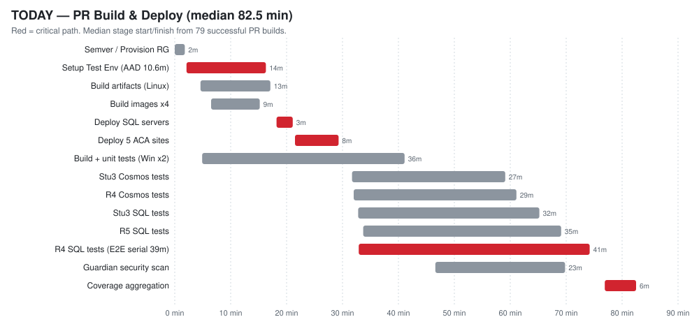
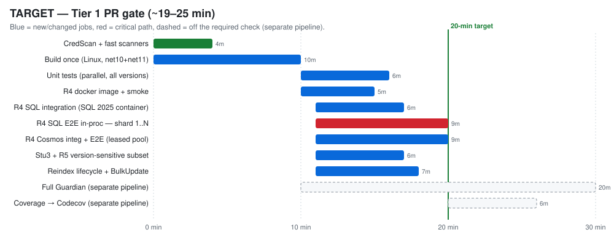

# ADR-2611: Tiered PR validation to keep the required check under 20 minutes

**Status**: Proposed
**Date**: 2026-11-16
**Feature**: CI/PR pipeline speedup

## Context

The required GitHub check for `main` is the Azure DevOps "PR Build & Deploy" run (definition 9, [build/pr-pipeline.yml](../../build/pr-pipeline.yml)); the only other required check is `license/cla`. Its median successful duration is 82.5 minutes (p90 93), and 31 of 292 PR builds in October–November 2026 needed a manual stage rerun to pass despite `--retry-failed-tests 3`.

The critical path is structural rather than incidental:

- **Per-PR Azure provisioning.** Every PR provisions its own environment: resource group, NSP, Key Vault, AAD test applications, two SQL servers, an ACA environment, five container apps and Cosmos. This takes about 29 minutes before any E2E test starts. The AAD setup job's median duration is 10.6 minutes. In build 53317, module preparation took about 53 seconds and `Add-AadTestAuthEnvironment` about 9 minutes 39 seconds, including repeated Graph propagation retries.
- **Serial E2E.** E2E tests run serially (`parallelizeTestCollections: false` in `test/Microsoft.Health.Fhir.Shared.Tests.E2E/xunit.runner.json`). The R4 SQL suite's 2,287 tests take 38.7 minutes, about their summed test duration.
- **Slow SQL integration.** SQL integration jobs (~32 minutes) are dominated by `SqlServerSqlCompatibilityTests`, which creates Azure SQL databases for each of its 13 tests.
- **Repeated work.** Unit-test projects run sequentially, twice, on Windows. The solution is compiled about eight times per PR. Coverage aggregation adds a 5.6-minute tail to the required run.

Every PR runs the same matrix: Stu3, R4 and R5 on SQL, plus Stu3 and R4 on Cosmos. R4B has test projects but is not scheduled anywhere. In the observed window, failures that appeared on only one FHIR version were spread across versions and cleared on rerun. No defect was seen that only a Stu3, R5 or Cosmos suite caught. The window is short and subject to survivorship bias, so this ADR does not treat the matrix as redundant. Instead it decides *when* and *where* each part of the matrix runs.

Version divergence lives mostly in 206 `#if` directives in shared code, in per-version search-parameter definitions, and in per-version Firely SDK packages. Cosmos is the store behind Azure API for FHIR, and parts of Cosmos query generation live in Core. Post-merge CI (definition 27, [build/ci-pipeline.yml](../../build/ci-pipeline.yml)) runs as batched CI on `main` only, against one shared environment. A failure there cannot be traced to a single merge today, and PRs into other branches never get post-merge validation.

### Prior attempt: #5265

[#5265](https://github.com/microsoft/fhir-server/pull/5265) (December 2025, closed unmerged) replaced the deployed R4B and R5 stages with Docker SQL Server 2022, the legacy Cosmos emulator and Azurite. Its Cosmos jobs failed after about 10 minutes. The build logs have aged out of retention, so the root cause cannot be confirmed. The diff and current test code point to these likely causes:

- **Emulator overload.** `CosmosDbFhirStorageTestsFixture` creates a container per fixture (`Guid` name, 1,500 RU/s). Roughly 54 fixture argument sets ran in parallel against an emulator capped at two partitions, 3 GB of memory and 2 CPUs.
- **Readiness checks that never failed.** The checks only fetched `emulator.pem`, and the wait loops continued on timeout.
- **One serial job.** A single job rebuilt the test projects and ran every suite in sequence, restarting SQL in between.
- **Immediate cutover.** The deployed stages were removed with no fallback.
- **Name filters.** Display-name filters selected the tests.

It also found that the Linux emulator needs Gateway connection mode. Container hosting is not more reliable by default. This ADR addresses each of these explicitly.

## Options Considered

1. **Optimize the current shape (deployed E2E on every PR)**: parallelize unit tests, shard E2E against the per-PR deployment, start scanners earlier. *(Rejected as the end state. Provisioning plus E2E against one shared deployment keeps the floor well above 40 minutes, and server-global tests cannot run concurrently against one endpoint.)*
2. **Warm pool of pre-provisioned environments leased per PR**: removes provisioning time. *(Rejected. Search parameters and reindex state are server-global, so each lease needs a full reset. Idle environments cost money.)*
3. **Tiered validation**: PRs run only against local containers (SQL Server, Cosmos emulator, Azurite). Real Azure SQL and Cosmos run post-merge, nightly, or on explicit request. *(Chosen.)*
4. **Tiered validation with path-triggered Azure deployment on PRs**: like option 3, but risky paths deploy today's Azure matrix on the PR. *(Rejected. Replaying the last 255 merges against the candidate path list, 59% would have triggered it. Package bumps, auth/SMART, `build/**` and search-parameter changes are frequent, so most PRs would stay slow.)*

## Decision

We will split validation into tiers. **Ordinary PRs are Azure-free.** Real Azure environments are deployed only for explicit Tier 2 requests, post-merge, and nightly. Nothing that runs on PRs today stops running; only its trigger and hosting change.

**Tier 1 — every PR, Azure-free, target p50 under 20 minutes.**

- **Build once** on Linux, both target frameworks, capturing analyzer results; later jobs reuse its outputs.
- **Unit tests** for every FHIR version in parallel; net10 as a separate parallel job.
- **R4 SQL E2E, full suite, in-proc**, against a pinned SQL Server 2025 Linux container (required by the schema's `vector(1536)` type) and Azurite.
- **R4 SQL integration tests** against the container, excluding schema-compatibility tests.
- **R4 Cosmos integration and E2E** against the legacy Cosmos emulator (below).
- **Stu3 and R5 version-sensitive subset**, selected by trait category: search, bundle and transaction, conformance, validate, patch, CRUD.
- **Reindex lifecycle check and BulkUpdate tests.**
- **One R4 amd64 image** from the published output, with an authenticated container smoke test.
- **Source scanners**, including CredScan, from time zero.

Full Guardian and coverage aggregation (Codecov) move to a separate, non-required pipeline triggered by the PR run.

**Sharding and isolation.** Tests are split into disjoint shards by measured duration. Each shard runs on its own agent with its own test process, database, and private SQL Server, Cosmos emulator and Azurite instances. Collections stay serial within a shard. Fixed storage endpoints and container names are therefore private, and isolation-sensitive classes (reindex, custom search parameters, history counts, import, bulk delete, export) are time-balanced across shards like any other class. Classes longer than the shard budget are split by test method, keeping each schema-upgrade sequence intact. This applies to E2E `ReindexTests` (22–26 minutes today), Cosmos `ReindexJobTests` (~9 minutes) and `SqlServerSqlCompatibilityTests` (~30 minutes on Azure SQL). Each shard is selected by one composed `--filter-query`. Shards are validated as disjoint and complete, and none may run zero tests.

**Tier 1+ — wider container coverage, path-triggered, still Azure-free.** A classifier at time zero adds container jobs that run in parallel with Tier 1:

- **Full Stu3 and R5 SQL E2E**, for package and SDK changes, version-specific source, search-parameter definitions and registry, or reindex code.
- **R4B SQL E2E**, for R4B-specific source.
- **Full reindex E2E**, for search-parameter or reindex code.
- **`SqlServerSqlCompatibilityTests` against the container, split by method**, for `src/Microsoft.Health.Fhir.SqlServer/**` or Core persistence changes. That is about 26% of recent merges.
- **All four images with smoke tests**, for Dockerfile or `build/**` changes.

**Tier 2 — real Azure on a PR, on request.** When full deployment is requested, today's deployed stages run inside the same required run (real Azure SQL, Cosmos, ACA, AAD, managed identity, Key Vault), in addition to Tier 1. It is requested by any of:

- **The `full-matrix` label**, applied by a maintainer; applying labels requires triage permission.
- **A manual run** with the `fullDeployment` parameter.
- **A PR targeting a `release/*` or `hotfix/*` branch**, or a same-repository source branch with those names. Fork branch names never qualify.

The label is expected (not enforced) for changes to `samples/templates/**`, Cosmos client initialization, collection setup or retry policies, authentication registration, or ACA/Key Vault configuration. These changed in under 5% of recent merges. This is the canonical list; reviewers request the label.

The classifier **fails closed**. If labels cannot be read completely after bounded retries, the required run fails rather than assuming "no label". Azure-targeted shards serialize conflicting workloads against the shared deployment; reindex tests, for example, cancel jobs and delete search parameters server-wide. Container shards do not need this. Tier 2 for fork PRs requires a maintainer-controlled execution path, because fork builds receive no secrets and a label does not grant them.

**One test definition, two targets.** The test code already switches on environment. E2E targets a deployed server when `TestEnvironmentUrl*` is set and runs in-proc otherwise. Integration fixtures take the SQL connection string and Cosmos host from configuration. One test-job template with a `container | azure` target is shared by the PR pipeline and post-merge CI, so their test selection stops diverging. Only setup and concurrency differ by target.

**Tier 3 — post-merge and nightly.**

- **Post-merge (definition 27):** batched CI runs the full deployed matrix on real Azure. This covers AAD, managed identity, Key Vault, multi-replica reindex, schema compatibility against Azure SQL, multi-arch images and full Guardian. It re-enables the Cosmos `ReindexOperation` jobs that today run only on PRs.
- **Bisect on failure:** a failed batch triggers a bisect that replays the merge SHAs in fresh environments. It must reproduce both the failure and a passing baseline, and otherwise reports "inconclusive". It never blames a PR for an infrastructure failure.
- **Fix ownership:** the merging PR's author owns the fix. Applied schema migrations are forward-fixed, not reverted.
- **Nightly:** ExportLongRunning, full reindex breadth, large import performance tests, schema compatibility across the full version range, CodeQL with a full build, and net10 E2E. The full schema range needs the tests' `Max−5..Max` window extended.

**Cosmos in Tier 1: the legacy Linux emulator.**

- **Which emulator.** Tier 1 uses `mcr.microsoft.com/cosmosdb/linux/azure-cosmos-emulator`, pinned by digest, one private instance per shard. The newer vNext emulator is not used. Its documentation lists stored procedures as "Not planned", and the server relies on four: `hardDelete`, `replaceSingleResource`, `acquireReindexJobs` and `updateUnsupportedSearchParameters`.
- **What it covers.** The legacy emulator runs the Cosmos query engine and stored procedures. It covers query generation, persistence and stored-procedure behavior, the main risk from Core changes.
- **Required test-hosting changes.**
  - **Gateway mode, set explicitly.** Cosmos fixtures must set `ConnectionMode`; today `CosmosDbFhirStorageTestsFixture` constructs its configuration without it, so an environment variable alone leaves Direct mode.
  - **A small, fixed set of pre-created containers per shard** replaces per-fixture `Guid` containers. Fixtures that need an empty container get a dedicated one, with cleanup between uses.
  - **Bounded fixture initialization**, with partition count and memory sized to the container set.
  - **A readiness probe** that exercises container creation, a query and a stored procedure, and fails the job on timeout.
- **What it misses.** Direct-mode transport, managed identity and data-plane RBAC, ARM container setup, throttling and 429 retries, partition splits, and current service query-engine behavior. These are covered by Tier 2 on request and by Tier 3.
- **Stability spike.** For about two weeks the emulator runs as a non-required job alongside today's deployed tests. It is x64 only, slow to start and was unreliable in #5265. **If the spike fails, Tier 1 cutover is blocked.** There is no shared-Azure fallback, so ordinary PRs stay Azure-free.

**Cutover gates.** Tier 1 replaces today's gate only when:

- **Parity.** A per-test-case inventory shows that everything skipped or behaving differently in-proc is covered by Tier 2 or Tier 3. Known differences: ACR anonymization and custom convert skip in-proc, OpenIddict replaces AAD, and import fault-injection assertions activate in-proc.
- **Shadow period.** Tier 1 has run as a non-required pipeline on all PRs. Its first-attempt pass rate is at least today's, its rerun rate is below 3%, and its measured p50 is under 20 minutes. The measurement includes startup, downloads, publishing and queueing.
- **Cosmos spike passed.**
- **Bisect operational.**

Rollout is phased: today's pipeline is optimized first without coverage change, then in-proc hosting runs in shadow, then cutover. Phase estimates and mechanics belong to the implementation plan.

## Consequences

- **Faster PRs.** Ordinary PRs target a p50 under 20 minutes, down from 82, once the gates pass. Optimizing today's pipeline alone gets to about 75 minutes: provisioning and serial deployed E2E remain on its critical path, and module caching saves under a minute.
- **Fewer Azure resources.** Ordinary PRs stop creating a resource group, NSP, Key Vault, AAD test applications, two SQL servers, an ACA environment, five container apps and a Cosmos account per build. The per-PR cleanup work goes with them.
- **Less real-Azure coverage before merge.** Real AAD, managed identity, Key Vault, ACA configuration, multi-replica cache sync, Azure SQL behavior, Cosmos Direct mode and throttling stop running on PRs unless Tier 2 is requested. Their regressions are caught post-merge and attributed by bisect, so `main` can be red for a batch.
- **Label discipline.** A forgotten label on a change from the canonical Tier 2 list is caught post-merge.
- **SQL container differences.** SQL authentication replaces Entra workload identity, and Azure SQL resource governance and Azure-only database options are not reproduced. Schema compatibility against Azure SQL runs in Tier 3.
- **New infrastructure to build and maintain:**
  - Packaged in-proc test configuration. `InProcTestFhirServer` reads `launchSettings.json` from the source tree today.
  - The shard harness.
  - Container readiness probes.
  - Emulator-mode Cosmos fixtures.
  - The fail-closed classifier.
  - The bisect orchestrator.

  More agents run per PR, and long classes split by method repeat their fixture setup.
- **New failure modes:**
  - Container start-up, and CPU or memory contention on agents, including timing-sensitive import assertions.
  - Azurite addressing.
  - Emulator fidelity.
  - GitHub API availability for the classifier.

  Each is measured during the shadow period. Retries are not raised to compensate.
- **Slow paths remain.** Full-deployment PRs and release/hotfix PRs keep today's duration, minus the optimization savings.
- **Other ADRs.** This ADR changes CI policy only. It does not change product behavior or the FHIR contract, and it supersedes no existing ADR.
