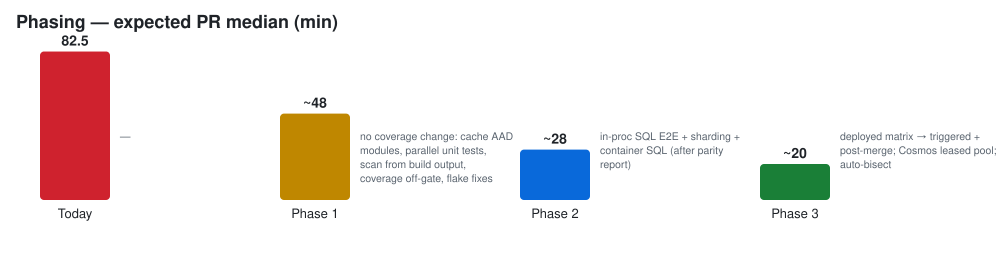

# ADR-2611: Tiered PR validation to keep the required check under 20 minutes

**Status**: Proposed
**Date**: 2026-11-16
**Feature**: CI/PR pipeline speedup

## Context

The required GitHub check for `main` is the Azure DevOps "PR Build & Deploy" run (definition 9, [build/pr-pipeline.yml](../../build/pr-pipeline.yml)); the only other required check is `license/cla`. Its median successful duration is 82.5 minutes (p90 93), and 31 of 292 PR builds in October–November 2026 needed a manual stage rerun to pass despite `--retry-failed-tests 3`.

The critical path is structural rather than incidental:

- **Per-PR Azure provisioning.** Every PR provisions its own environment: resource group, NSP, Key Vault, AAD test applications, two SQL servers, an ACA environment, five container apps and Cosmos. This takes about 29 minutes before any E2E test starts. The AAD setup job alone spends 10.6 minutes, largely reinstalling Graph and Az modules.
- **Serial E2E.** E2E tests run serially (`parallelizeTestCollections: false` in `test/Microsoft.Health.Fhir.Shared.Tests.E2E/xunit.runner.json`). The R4 SQL suite's 2,287 tests take 38.7 minutes, about their summed test duration.
- **Slow SQL integration.** SQL integration jobs (~32 minutes) are dominated by `SqlServerSqlCompatibilityTests`, which creates Azure SQL databases for each of its 13 tests.
- **Repeated work.** Unit-test projects run sequentially, twice, on Windows. The solution is compiled about eight times per PR. Coverage aggregation adds a 5.6-minute tail to the required run.

Every PR runs the same matrix: Stu3, R4 and R5 on SQL, plus Stu3 and R4 on Cosmos. In the observed window, failures that appeared on only one FHIR version were spread across versions and cleared on rerun. No defect was seen that only a Stu3, R5 or Cosmos suite caught. The window is short and subject to survivorship bias, so this ADR does not treat the matrix as redundant. Instead it decides *when* each part of the matrix must run.

Version divergence lives mostly in 206 `#if` directives in shared code, in per-version search-parameter definitions, and in per-version Firely SDK packages. Cosmos is the store behind Azure API for FHIR, and parts of Cosmos query generation live in Core. Post-merge CI (definition 27, [build/ci-pipeline.yml](../../build/ci-pipeline.yml)) runs as batched CI against one shared environment. A failure there cannot be traced to a single merge today.

## Options Considered

1. **Optimize the current shape (deployed E2E on every PR)**: cache modules, parallelize unit tests, shard E2E against the per-PR deployment, and start scanners earlier. *(Rejected as the end state. Per-PR provisioning keeps the floor at ~45–50 minutes. Kept as Phase 1 because it changes no coverage.)*
2. **Warm pool of pre-provisioned environments leased per PR**: removes provisioning time. *(Rejected. Search parameters and reindex state are server-global, so each lease needs a full reset. Idle environments cost money, and tests stay serial within an environment.)*
3. **Tiered validation**: in-proc E2E and local containers on every PR, the deployed matrix run conditionally within the required pipeline, and post-merge plus nightly breadth. *(Chosen.)*

## Decision

We will split validation into three tiers. Nothing that runs on PRs today stops running; only its trigger changes.

**Tier 1 — every PR, target under 20 minutes (p50).**

- **Build once.** A single Linux build covers both target frameworks and captures analyzer results. Later jobs reuse its outputs.
- **Unit tests.** All test projects for every FHIR version run in parallel. net10 runs as a separate parallel job.
- **R4 SQL E2E, full suite, in-proc.** Tests run in `InProcTestFhirServer` against a pinned SQL Server 2025 container (the schema uses `vector(1536)`) and Azurite. They are split into disjoint shards by measured class time. Each shard runs collections serially and gets its own database and storage. Classes that touch server-global state (reindex, custom search parameters, server-wide history counts, import, bulk delete, system export) share one serial shard.
- **R4 SQL integration tests** run against the container, excluding schema-compatibility tests.
- **R4 Cosmos integration and E2E** run against a persistent account through a leased container pool, described below.
- **Stu3 and R5 version-sensitive subset.** This is an explicit, checked-in manifest of discovered tests covering search, bundle and transaction, conformance, validate, patch and CRUD.
- **Reindex lifecycle check and BulkUpdate tests.**
- **One R4 amd64 image**, built from the published output, with an authenticated container smoke test.
- **Source scanners**, including CredScan, start at time zero.

Full Guardian and coverage aggregation with the Codecov upload move to a separate pipeline triggered by the PR run. That pipeline receives the PR number and head SHA explicitly. The build-once step replaces the Roslyn analyzer rebuild by capturing equivalent analyzer output.

**Tier 2 — the deployed matrix as it runs today, executed conditionally inside the same required run.** A classifier stage at time zero sets a variable that enables today's deployed stages. They run when any of the following applies:

- **Changed paths:** `Directory.Packages.props`, `global.json`, `build/**`, the Dockerfile, `samples/templates/**`, Stu3/R4B/R5-specific source, SQL `Schema/**`, Cosmos stored procedures, search-parameter definitions and the registry, reindex code, auth code, or `appsettings*.json`.
- **Opt-in:** a `full-matrix` label. Adding the label after the run has started requires re-queuing.
- **Branches:** every release and hotfix branch.

Changes under `src/Microsoft.Health.Fhir.SqlServer/**` or Core persistence code also run the schema-compatibility tests. Tier 2 runs inside "PR Build & Deploy" because a separately triggered, non-required pipeline cannot block a merge. It keeps today's deployed cells and stays slower than 20 minutes.

**Tier 3 — post-merge and nightly.** Definition 27 keeps batched CI and runs the full deployed matrix: real AAD, managed identity and Key Vault, multi-replica reindex, schema compatibility against Azure SQL, all images multi-arch, and full Guardian. It also re-enables the Cosmos `ReindexOperation` jobs that today run only on PRs. When a batch fails, a failure-triggered bisect replays the immutable merge SHAs in fresh environments. Before assigning a culprit it reproduces both the failure and a passing baseline. It reports an inconclusive result and never blames a PR for an infrastructure failure. The merging PR's author owns the fix. Revert is allowed except for applied schema migrations, which are forward-fixed. Nightly runs cover:

- ExportLongRunning
- Full reindex breadth
- Large import performance tests
- Schema compatibility across the full version range (which needs the compatibility tests' `Max−5..Max` window extended)
- CodeQL with a full build
- net10 E2E

**Cosmos leased pool.** The account keeps `disableLocalAuth = true`.

- **Preparation.** An ARM-driven job prepares each pool version for a specific set of stored-procedure hashes and indexing settings. Stored-procedure names include a hash of their bodies. PRs that change stored procedures therefore take Tier 2.
- **Leases.** Each isolated fixture or host takes its own lease, not one per PR. Every lease carries a generation token that locks out writers from earlier leases.
- **Reset.** Releasing a lease first stops all writers. It then deletes every document by its `(id, partitionKey)`, including status, job, lock and version documents, and verifies the container is empty before reinitializing it.
- **Failure.** A failed or cancelled reset quarantines the container rather than returning it to the pool. When the pool is exhausted, runs queue rather than fail.
- **Test changes.** Test hosting must use the pipeline's credential instead of the system-assigned managed identity, and fixtures must stop creating and deleting their own containers.

**Cutover gates.** Tier 1 replaces today's default gate only when all of the following hold:

- **Parity.** A per-test-case inventory shows that everything skipped or behaving differently in-proc is covered by Tier 2 or Tier 3. Known differences: ACR anonymization and custom convert skip in-proc, OpenIddict replaces AAD, and import fault-injection assertions activate in-proc.
- **Shadow period.** Tier 1 has run as a non-required shadow pipeline on all PRs. Its first-attempt pass rate is at least today's, and its rerun rate is below 3%.
- **Bisect ready.** Auto-bisect is operational.
- **Shard validation.** Shard filters are generated as a single `--filter-query` per shard, never mixed with `--filter-class`. They are validated as disjoint and complete, and no shard may run zero tests.

## Consequences

- **Faster PRs.** Ordinary PRs get a required check of about 19–25 minutes, down from 82, after three phases. Phase 1 brings it to about 45–50 minutes with no coverage change. Phase 2 adds in-proc SQL and sharding. Phase 3 makes the deployed matrix conditional.
- **Less real-deployment coverage on ordinary PRs.** Real AAD, managed identity, Key Vault, ACA configuration and multi-replica cache sync stop running on PRs that don't hit a Tier 2 trigger. Their regressions are caught post-merge and attributed by bisect, so main can be red for a batch before it is fixed.
- **New test infrastructure to build and maintain:**
  - In-proc configuration loading from packaged test artifacts. Today `InProcTestFhirServer` reads `launchSettings.json` from the source tree, and inherited remote test URLs must be cleared.
  - Generated shard manifests and the shard harness.
  - Container readiness probes for SQL schema and Azurite blob read/write; fixed sleeps don't count.
  - The Cosmos lease service with reset and quarantine, and RU budgeting for tests plus resets that honors 429 retry delays.
  - The bisect orchestrator.
- **New failure modes:**
  - Container start-up and agent CPU/memory contention, including timing-sensitive import assertions.
  - Azurite addressing. Helpers recognize local storage by loopback address.
  - Cosmos throttling, and lease leaks from cancelled builds.

  Each needs measurement during the shadow period. Retries are not raised to compensate.
- **Test burden.** Tests that rely on server-global state must be identified and kept on the serial shard. Cosmos fixtures change ownership semantics.
- **Faster than the current pipeline.** Tier 2 PRs (dependency bumps, build and schema changes, version-specific code) still take today's duration minus the Phase 1 savings.
- **Other ADRs.** This ADR changes CI policy only. It does not change product behavior or the FHIR contract, and it supersedes no existing ADR.
