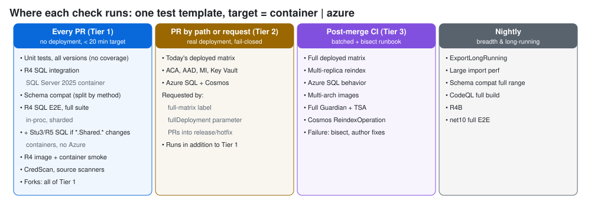

# ADR-2611: Tiered PR validation to keep the required check under 20 minutes

**Status**: Proposed
**Date**: 2026-11-16
**Feature**: CI/PR pipeline speedup

## Context

The required GitHub check for `main` is the Azure DevOps "PR Build & Deploy" run (definition 9, [build/pr-pipeline.yml](../../build/pr-pipeline.yml)); the only other required check is `license/cla`. Its median successful duration is 82.5 minutes (p90 93), and 31 of 292 PR builds in October–November 2026 needed a manual stage rerun to pass despite `--retry-failed-tests 3`.

The critical path is structural:

- **Per-PR Azure provisioning.** Every PR provisions a resource group, NSP, Key Vault, AAD test applications, two SQL servers, an ACA environment, five container apps and Cosmos. This takes about 29 minutes before any E2E test starts. The AAD setup job's median is 10.6 minutes; in build 53317, module preparation took about 53 seconds and `Add-AadTestAuthEnvironment` about 9 minutes 39 seconds.
- **Serial E2E against one deployed server.** The R4 SQL suite's 2,287 tests take 38.7 minutes (`parallelizeTestCollections: false`).
- **Integration tests on Azure SQL.** SQL integration jobs take about 32 minutes, dominated by `SqlServerSqlCompatibilityTests` (30.5 minutes). They also produce the most intermittent failures.
- **Repeated work.** Unit tests run sequentially, twice, on Windows. The solution compiles about eight times per PR. Coverage aggregation adds a 5.6-minute tail.

Every PR runs the same matrix: Stu3, R4 and R5 on SQL, plus Stu3 and R4 on Cosmos. No defect in the observed window was caught only by a Stu3, R5 or Cosmos suite, but the window is short. This ADR therefore decides *where and when* each suite runs, not whether it runs. Version divergence lives mostly in 206 `#if` directives in shared code. Cosmos is the store behind Azure API for FHIR, and parts of Cosmos query generation live in Core. Post-merge CI (definition 27) runs as batched CI on `main` only, against one shared environment.

### Evidence from local spikes (November 2026)

The spikes ran on a 16-CPU Windows host with Docker Desktop, not yet on Linux CI agents.

- **SQL Server 2025 container** (required by the schema's `vector(1536)` type). It is ready in about 27 seconds, and the schema deploys cleanly.
  - **SQL integration:** 804 tests take 7 minutes wall, versus about 32 minutes on Azure.
  - **Schema compatibility:** `SqlServerSqlCompatibilityTests` takes 4.4 minutes in one process. Its methods each create their own database, so split across 4 processes it takes 1.4 minutes.
  - **Container-only failures:** three. They come from row ordering, how a killed connection's error is classified, and dropping a database that's still in use. Each has a small test fix.
- **R4 SQL E2E in-proc.** It takes about 40 minutes in one process, no faster than deployed. **Split into 4 isolated shards (one database each) it took 12.1 minutes wall, with no cross-shard failures.**
  - In-proc runs 81 tests that the deployed run skips, and skips 56 that it runs, mostly `ConvertDataTests` and the ACR-dependent tests.
  - 18 in-proc-only failures repeat on rerun. Some are tests already broken on main that the deployed run never executes. The others come from the development identity provider (403 rather than 401), include limits, and an import fixture.
- **Legacy Linux Cosmos emulator: not viable.**
  - **#5265 settings** (2 partitions, 3 GB) failed 251 of 505 tests within 66 seconds, from partition exhaustion.
  - **Larger settings crash** (25 partitions, 8 GB, 4 CPUs). The emulator crashed in 7 of 8 Gateway runs with a resource error in its HTTP stack ("errno 11"). A standalone stress test reproduces the crash with 32 concurrent queries.
  - **Direct mode** fails the suite with "410 Gone" errors.
  - **The image is an evaluation build with an expiry date.**
  - **The newer vNext emulator** lacks stored procedures, and the server requires four.
- **Shard filters.** In this repository, a `--filter-query` that combines a path with a trait selects zero tests. Shards are selected with `--filter-method <Namespace.Class>.*` plus `--filter-trait`, which was verified complete against `--list-tests`.

### Evidence from Linux CI agents (PR runs 53402–53409, November 2026)

These runs used opt-in container stages that ran alongside the unchanged deployed stages.

- **SQL integration on a container:** 12–15 minutes per version, versus 31–33 minutes on Azure SQL.
- **R4 SQL E2E in-proc, 6 shards:**
  - 2,383 tests, with test steps of 6–13 minutes and jobs of 8–16 minutes.
  - With 4 agents in parallel, two shards waited about 13 minutes for an agent.
  - 11 failures appear only in-proc, in the same categories as the spike.
- **HistoryTests** in their own job: about 3 minutes, all versions passing.

### Where PR failures and changes fall

- **Failures.** Of about 86 failing test runs in 292 PR builds since July 2026:
  - about 24 involved Cosmos suites;
  - 5 reproduced only on Stu3 or R5.
- **Changes.** Of 214 merges to `main` in the same window:

  | Path | Share of merges |
  |---|---|
  | `src` or `test` projects containing `Cosmos` | 9% |
  | Stu3, R4B or R5 version-specific projects | 3% |
  | `build/**` | 15% |
  | Any of the three above | 23% |
  | `*.Shared.*` projects | 57% |

### Prior attempt: #5265

[#5265](https://github.com/microsoft/fhir-server/pull/5265) (closed unmerged) moved R4B and R5 to Docker SQL Server 2022, the legacy Cosmos emulator and Azurite. Its Cosmos jobs failed, and the spike above reproduced the cause. It also used weak readiness checks, ran every suite in one serial job, and removed the deployed stages with no fallback. This ADR keeps SQL on containers, where the spike shows they work, and keeps Cosmos on a real account.

## Options Considered

1. **Optimize the current shape**: parallel unit tests, scanners from build output, coverage off the required run. *(Kept as the first step, but rejected as the end state. Provisioning plus serial deployed E2E keeps the PR at about 75 minutes.)*
2. **Warm pool of pre-provisioned environments leased per PR.** *(Rejected. Server-global search-parameter and reindex state needs a full reset on every lease, and idle environments cost money.)*
3. **Everything in containers, including the Cosmos emulator.** *(Rejected. The legacy emulator crashes under the suite, and vNext lacks stored procedures.)*
4. **SQL and storage in containers, Cosmos on a shared pre-provisioned account, no per-PR deployment, all versions on every PR.** *(Superseded by option 6.)* This would test Cosmos and every version on every PR. It needs a privileged-adjacent shared Cosmos account, a dedicated identity, a sweeper and fork-PR exceptions, and about 15–20 agents per PR. The shared-account design is kept below as a contingency.
5. **Path-triggered Azure deployment on PRs, broad paths.** *(Rejected. Replaying the last 255 merges with Core, Shared and authentication paths included, 59% would have triggered it.)*
6. **Lean default with path-triggered depth.** *(Chosen.)*
   - **Every PR:** R4 on SQL, in containers, with no Azure.
   - **Changes to `*.Shared.*` code:** Stu3 and R5 SQL are added, also on containers.
   - **Cosmos, version-specific or pipeline paths, or the label:** the full deployed matrix runs.

   The narrow triggers fire on about 23% of merges. Post-merge CI on every merge catches the rest.

## Decision

We will split validation into tiers. **Ordinary PRs deploy no Azure environment and use no Azure credential.** By default a PR runs R4 against SQL Server and storage in containers on the agent. A path classifier adds depth where the change needs it. Real deployments (ACA, AAD test applications, Key Vault, Azure SQL, Cosmos) run on explicit or path-triggered request, after every merge and nightly. Nothing that runs on PRs today stops running; only its trigger and hosting change.

**Tier 1 — every PR, no deployment, target p50 under 20 minutes.**

- **Unit tests** for every FHIR version, split across parallel jobs, without coverage instrumentation. net10 runs as a separate parallel job.
- **R4 SQL integration tests** on a SQL Server 2025 container, split across two jobs. Schema compatibility tests are split by method.
- **R4 SQL E2E, full suite, in-proc** on SQL Server 2025 and Azurite containers, sharded.
- **Cross-version depth (Tier 1+).** When the PR changes `src/*.Shared.*` or `test/*.Shared.*` (about 57% of merges), Stu3 and R5 SQL integration and E2E are added on containers, in parallel with R4. Shared code is compiled into every version, and version divergence lives in its `#if` directives. This adds agents but no minutes, and no Azure.
- **One R4 amd64 image,** built locally (`--load`, not pushed to the shared registry). Its smoke test checks an authenticated request, and a negative control: without the development identity provider, the image returns 401.
- **Blocking source scanners:** CredScan, with the existing PostAnalysis break; CSRF; PSScriptAnalyzer; and Armory/TemplateAnalyzer. PR CodeQL (GitHub Actions) is unchanged.

The full solution, including Stu3, R4B and R5, still compiles on every PR in the unit-test jobs.

Full Guardian (BinSkim, Roslyn analyzers, AntiMalware) and coverage aggregation move to a separate, non-required pipeline, triggered by the PR run. It runs the Codecov upload once, credential-free, using a CLI pinned by a SHA-256 kept in the repository, and skips the upload when no token is available. Post-merge CI keeps full Guardian, and image promotion (`DockerAddTag`) depends on it. Fork PRs run all of Tier 1, because Tier 1 needs no secrets.

**Sharding and isolation.** Each shard runs on its own agent, with its own test process, its own database (unique `Initial Catalog`) and its own SQL Server and Azurite containers. Container ports bind to `127.0.0.1` only, because Azurite uses the public well-known development key. Azurite stays on port 10000, because three test helpers hard-code `127.0.0.1:10000`. Images are pinned by digest in a `FROM …@sha256` stub under `build/docker`, so Dependabot proposes updates. Collections stay serial within a shard. Shards come from a checked-in class-to-shard manifest built from measured durations. The last shard runs everything not listed, so new tests are always scheduled. Classes longer than the shard budget (`ImportTests`, `ReindexTests`, `SqlServerSqlCompatibilityTests`) are split by method.

**Time budget for the default path.** The numbers come from run 53409, where the container stages ran on Linux agents. A default PR made only by removing the Azure stages would still take about 42 minutes:

| Step | Time |
|---|---|
| Wait before the build starts (it depends on semver) | 4.3 min |
| Full Release build of every project | 15.2 min (job 19.8 min) |
| Stage boundary and artifact download | about 2.5 min |
| Shard setup | 2.7 min |
| Longest shard | 12.9 min |

Under 20 minutes needs every item below:

| Change | Target |
|---|---|
| Test builds start without waiting for semver | about 1 min |
| R4-only Release build of the test projects, either in each shard or as one job feeding a fan-out in the same stage | about 7 min (**unmeasured; the go/no-go number**) |
| Artifact handoff | about 1.5 min |
| Shard setup | about 2.7 min |
| Shards rebalanced from in-proc durations to 8–10 shards | longest about 7 min |

That totals about 19 minutes, so there is little slack.

- **Integration tests:** split in two, they fit the same budget.
- **Unit tests** must leave the critical path too. Today the net11 job takes 24.3 minutes and starts 9 minutes late: a 9.9-minute build plus 12.2 minutes of tests with coverage. It must start immediately, drop coverage instrumentation (net10's uninstrumented run takes 7.8 minutes) and split across two agents.
- **Agents:** the plan needs about 16 to start promptly. In run 53409, two shards waited 13 minutes, so pool capacity is a cutover risk. Removing the deployed stages frees about 25 job slots per PR.

The realistic expectation is a p50 of 19–22 minutes. The p90 will be higher, driven by agent queueing.

**Contingency: R4 Cosmos on a shared account.** This applies only if the 30-day review (Tier 3) shows Cosmos regressions reaching `main` more than about once a month. In that case R4 Cosmos integration and E2E join Tier 1, in-proc, against a shared Cosmos account. PR code, including test dependencies, must never hold today's privileged service connection. That connection can write role assignments and read the vault that holds tenant-admin secrets.

- **Dedicated identity.** Tier 1 Cosmos jobs use a new federated service connection whose only grants are:
  - a custom control-plane role limited to `sqlDatabases/containers/*`;
  - a data-plane contributor role.

  Both are scoped to one pre-created database in the shared account.
- **Account protection:**
  - The account has a `CanNotDelete` lock.
  - An Azure Policy denies `disableLocalAuth = false`.
  - Post-merge and nightly use a separate account, split by trust rather than load.
- **Isolation and cleanup:**
  - Each run creates containers named `pr<run id>-<suffix>` and deletes them at the end.
  - In-proc cleanup uses Entra authentication rather than the account key.
  - A sweeper runs from `main` with the same low-privilege identity, matching names with a strict regular expression through parameter-bound cmdlets.
- **Throughput.** Container creation goes through ARM, so it is serialized per account. Run concurrency and throughput are sized from measurement. If ARM throttling appears, runs spread across two or three accounts with the same scoping.
- **Fixture configuration.** The Cosmos test fixtures must honor the configured connection mode; today they construct their configuration without it.

**Tier 2 — real deployment on a PR, path-triggered or on request, with approval.** Today's deployed stages (Stu3, R4 and R5 on Azure SQL, plus Stu3 and R4 on Cosmos) run inside the same required run, in addition to Tier 1.

**The pipeline YAML comes from the PR, so the classifier is not a security boundary.** A PR author can edit it. The privileged service connection therefore carries an ADO approval check, and that per-run approval is the actual grant.

- **What a PR can request.** The run requests Tier 2 when the PR has the `full-matrix` label, when it was queued manually with `fullDeployment`, or when it targets `release/*` or `hotfix/*`. Same-repository source branches with those names also count; fork branch names never do. Detection requires `System.PullRequest.IsFork == False`, and branch names reach scripts through `env` only.
- **Who approves.** A maintainer approves the specific run after reviewing the commit being run. A label applied for an earlier commit does not carry approval forward.
- **Automatic labels.** The base-branch `validate-prs.yml` labeler applies `full-matrix` when a PR changes any of these paths. This is the canonical list.
  - `src/**` or `test/**` projects whose name contains `Cosmos`, including Cosmos client and collection setup;
  - version-specific projects, `src/*.{Stu3,R4B,R5}.*` and `test/*.{Stu3,R4B,R5}.*`;
  - `build/**`;
  - authentication;
  - `samples/templates/**`;
  - ACA or Key Vault configuration.

  Cosmos, version-specific and `build/**` changes together accounted for about 23% of merges in the observed window. Changes to `*.Shared.*` code alone add Stu3 and R5 on containers (Tier 1), not the deployed matrix.
- **Fork PRs never receive privileged secrets.** Tier 2 for a fork means a maintainer pushes the reviewed SHA to a same-repository branch and opens or queues from there. Manually queueing a fork's `refs/pull/<n>/merge` is not allowed.
- **Merge queue (future option, not adopted).** A GitHub merge queue could run the full matrix on every PR before it reaches `main`, which would remove post-merge breakage.
  - **Support is unproven.** Azure Pipelines has no `merge_group` event. It would work only through a CI trigger on `gh-readonly-queue/main/*` that reports "PR Build & Deploy" from definition 9 itself, and no public repository is confirmed to enforce a queue this way.
  - **Security.** Queue builds are base-repository CI builds, so fork code would reach service connections. The ADO approval check is required before any pilot.
  - **Operations.** Ejected builds keep running, and every merge waits for a 60–90-minute run.
  - **Next step.** Definition 9 is made queue-ready (the trigger, and a classifier that treats queue branches as full). A pilot on a test-branch ruleset needs a repository administrator.

The classifier **fails closed** for honest failures: if labels cannot be read completely, the run fails rather than assuming "no label". The label read is authenticated for same-repository PRs. Fork PRs skip it, since they cannot take Tier 2. On the deployed target, tests that assert server-wide counts (`HistoryTests`) run in their own job after the reindex and bulk-update jobs, which write to the same server.

**One test definition, two targets.** E2E targets a deployed server when `TestEnvironmentUrl*` is set and runs in-proc otherwise. One test-job template with a `container | azure` target is shared by the PR pipeline and post-merge CI; only setup and concurrency differ. `build-variables.yml` defines remote URLs globally, and ADO injects pipeline variables into every task's environment. So on the container target, the test launcher removes every `TestEnvironmentUrl*`, `TestTokenEndpoint` and `Resource` variable in its own process before starting tests, and fails if any remain. In-proc configuration (`launchSettings.json`) must be available next to the test binaries.

**Tier 3 — post-merge and nightly.** Definition 27 keeps CI with the full deployed matrix on every merge to `main`: real AAD, managed identity, Key Vault, multi-replica reindex, Azure SQL, Cosmos for Stu3 and R4, multi-arch images and full Guardian. Image promotion (`DockerAddTag`) also depends on security analysis. Definition 27 re-enables the Cosmos `ReindexOperation` jobs that today run only on PRs. Release and hotfix PRs always run Tier 2 with full Guardian, because those branches have no post-merge CI.

- **Revert first.** A definition 27 failure alerts the team channel. If a merged PR caused it, revert that PR first and investigate second, so `main` stays green for everyone. At about 0.6 merges a day, a failing CI run usually has one or two candidate commits.
- **30-day review.** For 30 days after cutover, record every definition 27 failure that Tier 1 would not have caught: Cosmos-only, version-only, or deployment-only. If Cosmos misses exceed about one a month, enable the shared-account contingency. If version misses do, widen the `*.Shared.*` trigger to a deployed run.

- **When a batch fails,** the on-call engineer runs a bisect script. It accepts only SHAs that are ancestors of `origin/main`, queues definition 9 on `refs/heads/main` at that SHA with full deployment and `prName=bisect-<id>`, and deletes its own resource groups. Queue permission is restricted to on-call.
- **Blame and ownership.** A culprit requires reproducing both the failure and a passing baseline, and infrastructure failures are never blamed on a PR. The merging PR's author owns the fix. Applied schema migrations are forward-fixed.
- **Automation.** Bisect is automated only if manual use proves frequent.
- **Nightly:** ExportLongRunning, large import performance tests, schema compatibility across the full version range (needs the `Max−5..Max` window extended), a full-build CodeQL run (in addition to PR CodeQL), R4B, and net10 E2E.

**Cutover gates.** Tier 1 replaces today's gate only when all of the following hold:

- **Parity.** In-proc-only failures in authentication, SMART or authorization tests are **fixed**, not tracked; the 403/401 differences are among them. The remaining in-proc-only failures are fixed or tracked. Every test skipped in-proc is covered by Tier 2 or Tier 3: ConvertData and ACR anonymization are known skips, and OpenIddict replaces AAD.
- **Shadow period.** Tier 1 has run as a non-required pipeline on Linux agents, with fan-out bounded so it does not disrupt shared-pool users. Its first-attempt pass rate is at least today's, its rerun rate is below 3%, and its measured p50 is under 20 minutes, including startup and queueing.
- **Path classifier.** The `full-matrix` and `*.Shared.*` triggers are in place, and each has been verified against replayed merges.
- **Revert-first.** The definition 27 failure alert and the revert-first rule are agreed by the team.
- **Approvals in place.** The ADO approval check exists on the privileged service connection.
- **Bisect.** The bisect runbook has been exercised once.

## Consequences

- **Faster PRs.**
  - Default PRs target a p50 under 20 minutes, down from 82. Removing the deployed stages alone gives about 42 minutes.
  - The rest depends on the R4-only test build, rebalanced shards, and moving unit-test coverage off the critical path (see the time budget).
  - PRs that trigger Tier 2 keep today's duration. In the observed window that was about 23% of PRs.
- **Far fewer Azure resources.** Default PRs create no resource groups, AAD applications, Key Vaults, SQL servers, ACA environments or Cosmos accounts, and need no shared account.
- **Less coverage before merge.**
  - **Cosmos.** Cosmos behavior reached through shared Core or `*.Shared.*` code is no longer tested on default PRs. About 28% of historical PR failing test runs involved Cosmos suites.
  - **Real deployments.** Real AAD, managed identity, Key Vault, ACA configuration, multi-replica cache sync and Azure SQL behavior run only in Tier 2.
  - Post-merge CI on every merge catches these, so `main` can be red until a revert. The 30-day review decides whether the Cosmos contingency is needed.
- **Version coverage tied to the change.** Stu3 and R5 run on containers whenever shared code changes, and deployed whenever version-specific code changes. A PR that touches neither runs R4 only. Historically only 5 of about 86 failing test runs reproduced only on Stu3 or R5. In-proc also runs 81 tests that the deployed run skips today.
- **SQL container differences.** SQL authentication replaces Entra workload identity, and Azure SQL resource governance and Azure-only options are not reproduced. Tier 2 and Tier 3 cover them.
- **Smaller credential exposure.**
  - Default PR code holds no Azure credential at all, and fork PRs run the same Tier 1 as same-repository PRs.
  - Privileged runs need a per-run maintainer approval, which needs an approval check configured in ADO.
  - The shared Cosmos account's identity, role, lock and policy are only needed if the contingency is enabled.
- **Approval load.** About a quarter of PRs trigger Tier 2 automatically, and each needs a maintainer to approve the run.
- **Security analysis.** CredScan, CSRF, PSScriptAnalyzer and template analyzers stay blocking on PRs, and PR CodeQL is unchanged. BinSkim, Roslyn analyzers and AntiMalware block post-merge image promotion and release/hotfix PRs instead of every PR.
- **New infrastructure and test work.**
  - Packaged in-proc configuration, the container-target template, and the shard manifest with its update script.
  - The R4-only test build and the path classifier, which fails closed.
  - The definition 27 failure alert, the bisect runbook, three container-specific integration-test fixes, and the in-proc-only failures (11 on Linux agents, 18 in the local spike).
- **Agents per PR.** A default PR uses about 16 agents. Shared-code PRs use more for Stu3 and R5. Today a PR runs about 25 jobs, most of which wait on provisioning.
- **New failure modes.** Container start-up and host contention, agent-pool queueing, and Cosmos or version regressions found only after merge. These are measured in the shadow period and the 30-day review; retries are not raised to compensate.
- **Other ADRs.** This ADR changes CI policy only. It does not change product behavior or the FHIR contract, and it supersedes no existing ADR.