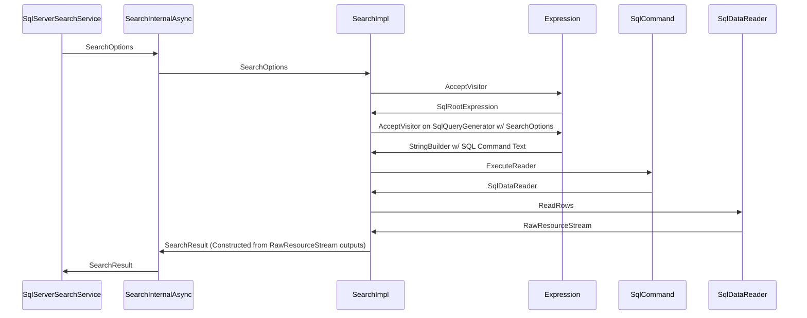

## SQL generation

See [SQL generation](../SqlSearchArchitecture.md#sql-generation) in the SQL Server search architecture.

### Query shape comments

See [query shape comments](../SqlSearchArchitecture.md#query-shape-comments) for annotation formats and query-plan reuse behavior.
