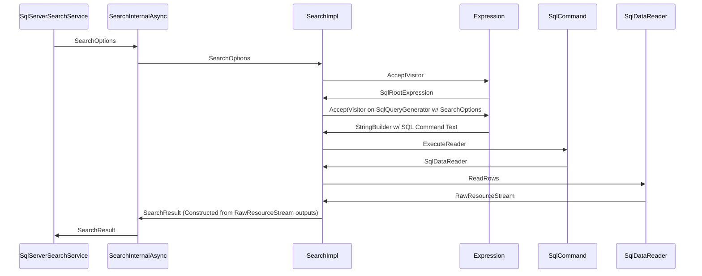

## SQL generation

See [SQL generation](../SqlSearchArchitecture.md#sql-generation) in the SQL Server search architecture.

`SqlServerSearchService` passes a rewritten `SqlRootExpression` to `SqlQueryGenerator`, which emits the SQL
statements and CTEs for the search. The generator uses `EXISTS` for source-existence checks when practical.
For complex searches or optimizer retries, it can use joins instead. The final query applies resource-version
and deletion filters, sorting, and pagination, then returns distinct resources. Include searches save the
matched resources before generating queries for included resources.

Independent chained parameters can match different referenced resources. When
`FhirSqlServer:EnableChainSourceDeduplication` is enabled and the generator uses joins, it intersects
independent chains, and root-level filters that follow a chain, on distinct source-resource keys so multiple
matches in one chain do not multiply rows in later tables. This option is disabled by default.

### Query shape comments

See [query shape comments](../SqlSearchArchitecture.md#query-shape-comments) for annotation formats and query-plan reuse behavior.
